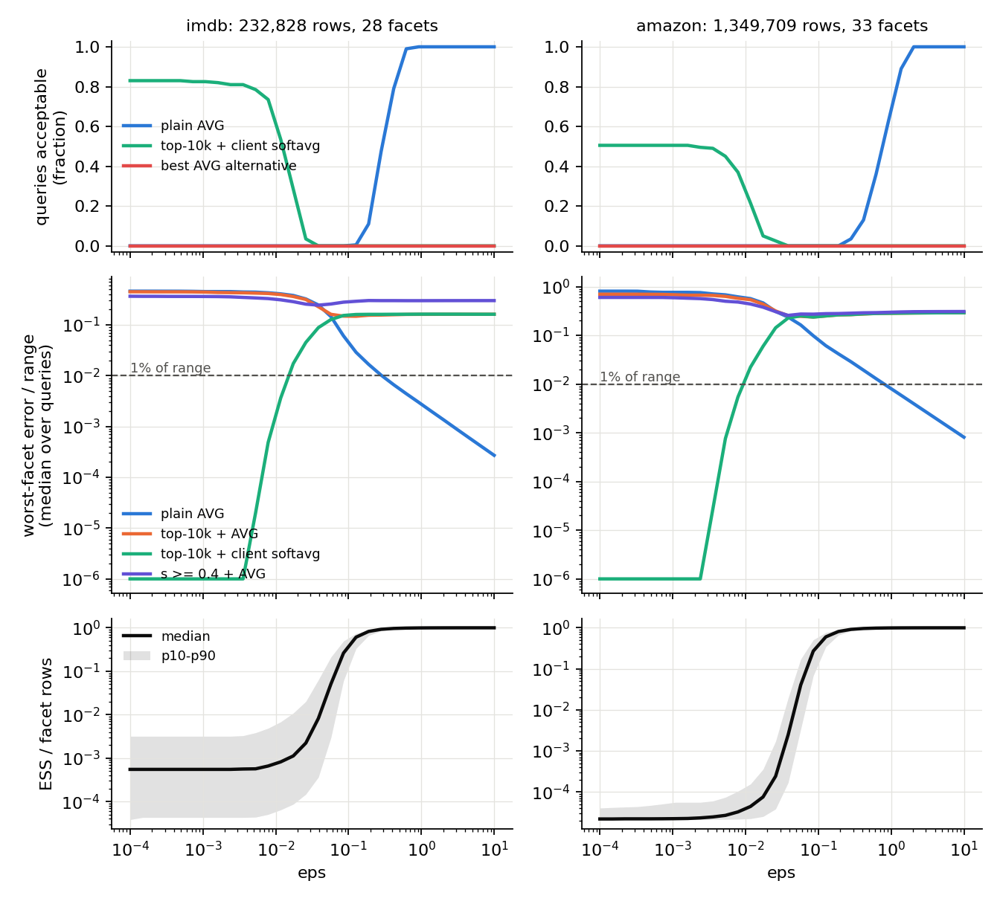

# eps crossover: exact softavg vs the host-native alternatives (IMDb, Amazon)

Answers the question ("crossover curves beyond two temperatures, regimes where approximations
exchange accuracy advantages"). Accuracy only, no timings (numpy float64 reference; the
`timing_status` field says so). Produced 2026-11-06 by `run_crossover.py`; figure by
`make_figure.py`, tables below by `make_tables.py`. Both read `results.json` only.

## Setup

- Corpora (read-only): `/data/softavg/corpora/{imdb,amazon}`; predicates of
  PROTOCOL.md (IMDb `filter_num >= 2000`: 232,828 rows, 28 facets; Amazon
  `filter_num >= 2015`: 1,349,709 rows, 33 facets).
- 200 queries per corpus, chosen as in PROTOCOL.md (`RandomState(0)`, first sentence 4-20
  words, de-duplicated); rows in `results.json -> corpora.*.query_rows`. Score = float64
  inner product of the 384-d MiniLM embeddings.
- eps grid: 30 log-spaced values in [1e-4, 10] plus inf.
- Reference: exact per-facet softavg over all admitted rows (float64, max-shifted).
- Alternatives a user writes today without our aggregate:
  - `plain_avg`: `AVG(value) GROUP BY facet`.
  - `topk_avg_k`: idealised index (exact global top-k, numpy), then AVG per facet;
    k = 100, 1000, 4096 (sqlite-vec cap), 10000.
  - `topk_softavg_k`: same top-k, softavg computed client-side over it (what a vector-DB user
    can do with the returned scores; see `../vectordb`).
  - `thresh_avg_tau`: `WHERE score >= tau`, AVG per facet; tau = 0.3, 0.4, 0.5, 0.6.
  - `sample_avg_n`: uniform random sample of n admitted rows (n = the k values), AVG per facet.
- Metric per (query, facet): |answer - reference| / range_f, with range_f = max - min of the
  facet's admitted values. A facet with no row in the candidate set is "not covered".
- **Acceptable**: a query is acceptable for a method at eps iff every facet is covered and
  every facet error is <= 1% of its range. We also report the same with covered facets only,
  to separate "missing" from "wrong".
- Diagnostic: per (query, facet, eps) effective sample size ESS = (sum w)^2 / sum w^2, absolute
  and as a fraction of the facet's row count n_f.

## Findings (numbers are grid points from the tables below)

1. **Two regimes, and a gap between them where nothing native is acceptable.**
   - At sharp eps, top-k + client-side softavg is acceptable. With k = 10000 it holds for the
     median query up to eps = 0.0117 on IMDb and 0.0016 on Amazon. It never reaches 90% of
     queries, because some queries miss a facet entirely: 166/200 IMDb queries and 101/200
     Amazon queries have full coverage at k = 10000.
   - On covered facets alone, top-k softavg is accurate up to eps of about 0.005 to 0.012 for
     *every* k, including k = 100. Small k fails on coverage, not on error.
   - At flat eps, plain AVG is acceptable. It holds for the median query from eps = 0.42 on
     IMDb and 0.92 on Amazon, and for 90% of queries from 0.62 and 2.04.
   - Between those, no alternative is acceptable for the median query: eps = 0.017 to 0.28 on
     IMDb and 0.0024 to 0.62 on Amazon.
   - Two eps values from the PROTOCOL grid, 0.02 and 0.1, lie inside this gap on both corpora.
2. **ESS predicts the crossover.**
   - Top-k softavg is right when the weight sits on a handful of rows. Per (query, facet)
     cell, it is within 1% in 99% (IMDb) and 95% (Amazon) of cells with ESS < 1.5, and in about
     50% of cells at ESS 10 to 30.
   - Plain AVG is right when ESS/n_f is close to 1. It is within 1% in 99.8% (IMDb) and 91%
     (Amazon) of cells with ESS/n_f >= 0.9, and in under 9% of cells with ESS/n_f < 0.01.
   - The gap is the stretch of eps where the median ESS climbs from about 2 rows to about
     0.95·n_f.
   - It sits at a different absolute eps on each corpus, because Amazon's facets are 20 times
     larger. The ESS axis is what transfers between corpora; the eps axis does not.
3. **top-k + AVG, threshold + AVG and uniform sample + AVG are never acceptable** on either
   corpus, at any eps, for any k, tau or n tested. That holds for the median query and also on
   covered facets only.
   - Top-k + AVG and threshold + AVG compute an unweighted mean of a biased subset. It equals
     softavg at no eps.
   - A 10k uniform sample estimates plain AVG, but the smallest facets get a few rows. IMDb's
     smallest facet has 92 rows, about 4 in a 10k sample, so the worst facet is off by more
     than 1% even at eps = inf.
4. **Where the natives are fine** (to be said in the paper):
   - eps >= about 1 (IMDb) or 2 (Amazon): plain AVG.
   - eps <= about 0.005: per-facet top hits with client-side softavg. The vector-DB grouping
     APIs in `../vectordb` give exactly this, with full coverage.

**Surprise.** On Amazon, top-k + AVG and a small uniform sample are "acceptable" for 16 to 24%
of (query, facet) cells at sharp eps. Most ratings are 5 stars, so an unweighted mean of a few
5s happens to equal the top-1 row's value. This is a property of the data, not accuracy, and it
does not survive the query-level criterion.

## Tables (generated from results.json; do not edit by hand)

<!-- AUTO-TABLES BEGIN -->

### imdb (232,828 admitted rows, 28 facets, filter_num >= 2000, smallest facet 92 rows)

Acceptable eps ranges (grid points; query acceptable = all facets covered and every facet error <= 1% of range):

| method | rows in set (median) | coverage mean | queries full cov. | eps acceptable, median query | eps acceptable, 90% of queries | median query, covered facets only |
|---|---|---|---|---|---|---|
| plain_avg | 232828 | 1.000 | 200 | 0.417532 .. inf | 0.621017 .. inf | 0.417532 .. inf |
| topk_avg_k100 | 100 | 0.489 | 0 | never | never | never |
| topk_avg_k1000 | 1000 | 0.865 | 1 | never | never | never |
| topk_avg_k4096 | 4096 | 0.968 | 71 | never | never | never |
| topk_avg_k10000 | 10000 | 0.994 | 166 | never | never | never |
| topk_softavg_k100 | 100 | 0.489 | 0 | never | never | 0.0001 .. 0.00788046 |
| topk_softavg_k1000 | 1000 | 0.865 | 1 | never | never | 0.0001 .. 0.00529832 |
| topk_softavg_k4096 | 4096 | 0.968 | 71 | never | never | 0.0001 .. 0.00788046 |
| topk_softavg_k10000 | 10000 | 0.994 | 166 | 0.0001 .. 0.011721 | never | 0.0001 .. 0.011721 |
| thresh_avg_tau0.3 | 6582 | 0.964 | 108 | never | never | never |
| thresh_avg_tau0.4 | 722 | 0.769 | 9 | never | never | never |
| thresh_avg_tau0.5 | 78 | 0.448 | 0 | never | never | never |
| thresh_avg_tau0.6 | 10 | 0.188 | 0 | never | never | never |
| sample_avg_n100 | 100 | 0.580 | 0 | never | never | never |
| sample_avg_n1000 | 1000 | 0.920 | 8 | never | never | never |
| sample_avg_n4096 | 4096 | 0.985 | 125 | never | never | never |
| sample_avg_n10000 | 10000 | 0.999 | 196 | never | never | never |

Worst covered-facet error / range, median over queries (every 3rd grid point):

| method | 0.0001 | 0.000329034 | 0.00108264 | 0.00356225 | 0.011721 | 0.0385662 | 0.126896 | 0.417532 | 1.37382 | 4.52035 | inf |
|---|---|---|---|---|---|---|---|---|---|---|---|
| ESS median | 1 | 1 | 1 | 1 | 1.38 | 13.8 | 1.1e+03 | 1.86e+03 | 1.97e+03 | 1.97e+03 | 1.98e+03 |
| ESS / n_f median | 0.00055 | 0.00055 | 0.00055 | 0.00056 | 0.00082 | 0.0082 | 0.61 | 0.97 | 1 | 1 | 1 |
| plain_avg | 0.46 | 0.46 | 0.45 | 0.45 | 0.41 | 0.25 | 0.029 | 0.0066 | 0.002 | 0.0006 | 0 |
| topk_avg_k100 | 0.29 | 0.29 | 0.28 | 0.28 | 0.25 | 0.21 | 0.31 | 0.32 | 0.32 | 0.32 | 0.32 |
| topk_avg_k1000 | 0.39 | 0.39 | 0.38 | 0.37 | 0.33 | 0.25 | 0.3 | 0.3 | 0.3 | 0.31 | 0.31 |
| topk_avg_k4096 | 0.44 | 0.43 | 0.43 | 0.42 | 0.39 | 0.23 | 0.22 | 0.23 | 0.23 | 0.23 | 0.23 |
| topk_avg_k10000 | 0.45 | 0.45 | 0.44 | 0.43 | 0.4 | 0.23 | 0.15 | 0.16 | 0.16 | 0.16 | 0.16 |
| topk_softavg_k100 | 0 | 0 | 6.4e-11 | 0.00023 | 0.028 | 0.18 | 0.32 | 0.32 | 0.32 | 0.32 | 0.32 |
| topk_softavg_k1000 | 0 | 0 | 6.3e-10 | 0.0004 | 0.033 | 0.21 | 0.3 | 0.3 | 0.3 | 0.3 | 0.31 |
| topk_softavg_k4096 | 0 | 0 | 3.8e-14 | 3.4e-05 | 0.015 | 0.14 | 0.23 | 0.23 | 0.23 | 0.23 | 0.23 |
| topk_softavg_k10000 | 0 | 0 | 2.3e-16 | 2.4e-07 | 0.0036 | 0.089 | 0.16 | 0.16 | 0.16 | 0.16 | 0.16 |
| thresh_avg_tau0.3 | 0.44 | 0.44 | 0.43 | 0.42 | 0.39 | 0.24 | 0.19 | 0.2 | 0.2 | 0.2 | 0.2 |
| thresh_avg_tau0.4 | 0.37 | 0.36 | 0.36 | 0.35 | 0.31 | 0.24 | 0.29 | 0.3 | 0.3 | 0.3 | 0.3 |
| thresh_avg_tau0.5 | 0.26 | 0.25 | 0.25 | 0.24 | 0.22 | 0.19 | 0.27 | 0.28 | 0.28 | 0.28 | 0.28 |
| thresh_avg_tau0.6 | 0.13 | 0.13 | 0.13 | 0.12 | 0.1 | 0.11 | 0.22 | 0.22 | 0.22 | 0.22 | 0.22 |
| sample_avg_n100 | 0.51 | 0.51 | 0.51 | 0.5 | 0.47 | 0.37 | 0.33 | 0.34 | 0.34 | 0.34 | 0.34 |
| sample_avg_n1000 | 0.53 | 0.53 | 0.53 | 0.52 | 0.49 | 0.36 | 0.29 | 0.3 | 0.3 | 0.3 | 0.3 |
| sample_avg_n4096 | 0.5 | 0.5 | 0.5 | 0.49 | 0.44 | 0.31 | 0.2 | 0.19 | 0.19 | 0.19 | 0.19 |
| sample_avg_n10000 | 0.48 | 0.48 | 0.48 | 0.46 | 0.43 | 0.29 | 0.16 | 0.15 | 0.15 | 0.15 | 0.15 |

Fraction of queries acceptable (same grid points):

| method | 0.0001 | 0.000329034 | 0.00108264 | 0.00356225 | 0.011721 | 0.0385662 | 0.126896 | 0.417532 | 1.37382 | 4.52035 | inf |
|---|---|---|---|---|---|---|---|---|---|---|---|
| plain_avg | 0.00 | 0.00 | 0.00 | 0.00 | 0.00 | 0.00 | 0.01 | 0.79 | 1.00 | 1.00 | 1.00 |
| topk_avg_k100 | 0.00 | 0.00 | 0.00 | 0.00 | 0.00 | 0.00 | 0.00 | 0.00 | 0.00 | 0.00 | 0.00 |
| topk_avg_k1000 | 0.00 | 0.00 | 0.00 | 0.00 | 0.00 | 0.00 | 0.00 | 0.00 | 0.00 | 0.00 | 0.00 |
| topk_avg_k4096 | 0.00 | 0.00 | 0.00 | 0.00 | 0.00 | 0.00 | 0.00 | 0.00 | 0.00 | 0.00 | 0.00 |
| topk_avg_k10000 | 0.00 | 0.00 | 0.00 | 0.00 | 0.00 | 0.00 | 0.00 | 0.00 | 0.00 | 0.00 | 0.00 |
| topk_softavg_k100 | 0.00 | 0.00 | 0.00 | 0.00 | 0.00 | 0.00 | 0.00 | 0.00 | 0.00 | 0.00 | 0.00 |
| topk_softavg_k1000 | 0.01 | 0.01 | 0.01 | 0.01 | 0.00 | 0.00 | 0.00 | 0.00 | 0.00 | 0.00 | 0.00 |
| topk_softavg_k4096 | 0.35 | 0.35 | 0.35 | 0.32 | 0.10 | 0.00 | 0.00 | 0.00 | 0.00 | 0.00 | 0.00 |
| topk_softavg_k10000 | 0.83 | 0.83 | 0.82 | 0.81 | 0.54 | 0.00 | 0.00 | 0.00 | 0.00 | 0.00 | 0.00 |
| thresh_avg_tau0.3 | 0.00 | 0.00 | 0.00 | 0.00 | 0.00 | 0.00 | 0.00 | 0.00 | 0.00 | 0.00 | 0.00 |
| thresh_avg_tau0.4 | 0.00 | 0.00 | 0.00 | 0.00 | 0.00 | 0.00 | 0.00 | 0.00 | 0.00 | 0.00 | 0.00 |
| thresh_avg_tau0.5 | 0.00 | 0.00 | 0.00 | 0.00 | 0.00 | 0.00 | 0.00 | 0.00 | 0.00 | 0.00 | 0.00 |
| thresh_avg_tau0.6 | 0.00 | 0.00 | 0.00 | 0.00 | 0.00 | 0.00 | 0.00 | 0.00 | 0.00 | 0.00 | 0.00 |
| sample_avg_n100 | 0.00 | 0.00 | 0.00 | 0.00 | 0.00 | 0.00 | 0.00 | 0.00 | 0.00 | 0.00 | 0.00 |
| sample_avg_n1000 | 0.00 | 0.00 | 0.00 | 0.00 | 0.00 | 0.00 | 0.00 | 0.00 | 0.00 | 0.00 | 0.00 |
| sample_avg_n4096 | 0.00 | 0.00 | 0.00 | 0.00 | 0.00 | 0.00 | 0.00 | 0.00 | 0.00 | 0.00 | 0.00 |
| sample_avg_n10000 | 0.00 | 0.00 | 0.00 | 0.00 | 0.00 | 0.00 | 0.00 | 0.00 | 0.00 | 0.00 | 0.00 |

ESS diagnostic: fraction of (query, facet, eps) cells within 1%, binned by ESS:

| method \ ESS / n_f bin | [0, 0.0001) | [0.0001, 0.001) | [0.001, 0.01) | [0.01, 0.03) | [0.03, 0.1) | [0.1, 0.3) | [0.3, 0.6) | [0.6, 0.9) | [0.9, 1) |
|---|---|---|---|---|---|---|---|---|---|
| cells | 13590 | 39950 | 27753 | 8937 | 3977 | 4398 | 5047 | 9725 | 60223 |
| plain_avg | 0.039 | 0.043 | 0.055 | 0.085 | 0.28 | 0.43 | 0.64 | 0.87 | 1 |
| sample_avg_n100 | 0.035 | 0.024 | 0.013 | 0.014 | 0.036 | 0.041 | 0.044 | 0.045 | 0.047 |
| sample_avg_n1000 | 0.043 | 0.044 | 0.042 | 0.048 | 0.12 | 0.13 | 0.14 | 0.15 | 0.17 |
| sample_avg_n4096 | 0.041 | 0.038 | 0.049 | 0.064 | 0.19 | 0.23 | 0.27 | 0.3 | 0.33 |
| sample_avg_n10000 | 0.042 | 0.042 | 0.053 | 0.075 | 0.23 | 0.3 | 0.36 | 0.41 | 0.45 |
| thresh_avg_tau0.3 | 0.047 | 0.054 | 0.11 | 0.2 | 0.29 | 0.3 | 0.27 | 0.23 | 0.21 |
| thresh_avg_tau0.4 | 0.053 | 0.14 | 0.17 | 0.16 | 0.13 | 0.11 | 0.1 | 0.094 | 0.091 |
| thresh_avg_tau0.5 | 0.14 | 0.19 | 0.11 | 0.041 | 0.036 | 0.035 | 0.034 | 0.034 | 0.036 |
| thresh_avg_tau0.6 | 0.21 | 0.12 | 0.027 | 0.0067 | 0.008 | 0.0061 | 0.0085 | 0.0078 | 0.0097 |

| method \ ESS (absolute) bin | [0, 1.5) | [1.5, 3) | [3, 10) | [10, 30) | [30, 100) | [100, 300) | [300, 1e+03) | [1000, 3e+03) | [3000, 1e+04) | [10000, 1e+05) |
|---|---|---|---|---|---|---|---|---|---|---|
| cells | 67438 | 11092 | 7151 | 3854 | 8889 | 4242 | 20889 | 21713 | 15720 | 12612 |
| topk_avg_k100 | 0.19 | 0.071 | 0.048 | 0.039 | 0.014 | 0.027 | 0.012 | 0.024 | 0.045 | 0.12 |
| topk_avg_k1000 | 0.13 | 0.07 | 0.087 | 0.11 | 0.064 | 0.11 | 0.053 | 0.1 | 0.15 | 0.28 |
| topk_avg_k4096 | 0.075 | 0.064 | 0.1 | 0.15 | 0.11 | 0.21 | 0.12 | 0.18 | 0.26 | 0.38 |
| topk_avg_k10000 | 0.053 | 0.057 | 0.092 | 0.16 | 0.14 | 0.28 | 0.18 | 0.26 | 0.37 | 0.46 |
| topk_softavg_k100 | 0.5 | 0.36 | 0.18 | 0.054 | 0.015 | 0.025 | 0.01 | 0.021 | 0.043 | 0.12 |
| topk_softavg_k1000 | 0.87 | 0.72 | 0.45 | 0.21 | 0.066 | 0.087 | 0.05 | 0.1 | 0.14 | 0.28 |
| topk_softavg_k4096 | 0.97 | 0.89 | 0.68 | 0.39 | 0.14 | 0.2 | 0.11 | 0.18 | 0.26 | 0.37 |
| topk_softavg_k10000 | 0.99 | 0.95 | 0.8 | 0.54 | 0.21 | 0.3 | 0.17 | 0.25 | 0.37 | 0.45 |

### amazon (1,349,709 admitted rows, 33 facets, filter_num >= 2015, smallest facet 3,244 rows)

Acceptable eps ranges (grid points; query acceptable = all facets covered and every facet error <= 1% of range):

| method | rows in set (median) | coverage mean | queries full cov. | eps acceptable, median query | eps acceptable, 90% of queries | median query, covered facets only |
|---|---|---|---|---|---|---|
| plain_avg | 1349709 | 1.000 | 200 | 0.923671 .. inf | 2.04336 .. inf | 0.923671 .. inf |
| topk_avg_k100 | 100 | 0.298 | 0 | never | never | never |
| topk_avg_k1000 | 1000 | 0.642 | 2 | never | never | never |
| topk_avg_k4096 | 4096 | 0.854 | 36 | never | never | never |
| topk_avg_k10000 | 10000 | 0.945 | 101 | never | never | never |
| topk_softavg_k100 | 100 | 0.298 | 0 | never | never | 0.0001 .. 0.00788046 |
| topk_softavg_k1000 | 1000 | 0.642 | 2 | never | never | 0.0001 .. 0.00529832 |
| topk_softavg_k4096 | 4096 | 0.854 | 36 | never | never | 0.0001 .. 0.00529832 |
| topk_softavg_k10000 | 10000 | 0.945 | 101 | 0.0001 .. 0.00161026 | never | 0.0001 .. 0.00788046 |
| thresh_avg_tau0.3 | 34515 | 0.985 | 163 | never | never | never |
| thresh_avg_tau0.4 | 5692 | 0.853 | 64 | never | never | never |
| thresh_avg_tau0.5 | 678 | 0.554 | 16 | never | never | never |
| thresh_avg_tau0.6 | 45 | 0.264 | 3 | never | never | never |
| sample_avg_n100 | 100 | 0.917 | 7 | never | never | never |
| sample_avg_n1000 | 1000 | 0.996 | 173 | never | never | never |
| sample_avg_n4096 | 4096 | 1.000 | 200 | never | never | never |
| sample_avg_n10000 | 10000 | 1.000 | 200 | never | never | never |

Worst covered-facet error / range, median over queries (every 3rd grid point):

| method | 0.0001 | 0.000329034 | 0.00108264 | 0.00356225 | 0.011721 | 0.0385662 | 0.126896 | 0.417532 | 1.37382 | 4.52035 | inf |
|---|---|---|---|---|---|---|---|---|---|---|---|
| ESS median | 1 | 1 | 1 | 1.01 | 1.73 | 91.4 | 2.49e+04 | 4.34e+04 | 4.56e+04 | 4.57e+04 | 4.57e+04 |
| ESS / n_f median | 2.2e-05 | 2.2e-05 | 2.2e-05 | 2.5e-05 | 4.4e-05 | 0.0025 | 0.6 | 0.96 | 1 | 1 | 1 |
| plain_avg | 0.81 | 0.81 | 0.76 | 0.71 | 0.57 | 0.24 | 0.061 | 0.019 | 0.0059 | 0.0018 | 0 |
| topk_avg_k100 | 0.22 | 0.21 | 0.21 | 0.21 | 0.18 | 0.19 | 0.22 | 0.23 | 0.24 | 0.24 | 0.24 |
| topk_avg_k1000 | 0.5 | 0.5 | 0.49 | 0.43 | 0.34 | 0.28 | 0.32 | 0.31 | 0.31 | 0.31 | 0.31 |
| topk_avg_k4096 | 0.64 | 0.64 | 0.62 | 0.59 | 0.49 | 0.26 | 0.27 | 0.29 | 0.31 | 0.31 | 0.31 |
| topk_avg_k10000 | 0.7 | 0.7 | 0.68 | 0.66 | 0.54 | 0.25 | 0.25 | 0.27 | 0.29 | 0.29 | 0.29 |
| topk_softavg_k100 | 0 | 0 | 5.6e-15 | 2.3e-05 | 0.019 | 0.17 | 0.21 | 0.23 | 0.24 | 0.24 | 0.24 |
| topk_softavg_k1000 | 0 | 0 | 1.5e-10 | 0.00049 | 0.046 | 0.27 | 0.31 | 0.31 | 0.31 | 0.31 | 0.31 |
| topk_softavg_k4096 | 0 | 8.3e-17 | 4e-12 | 0.00021 | 0.031 | 0.25 | 0.28 | 0.29 | 0.31 | 0.31 | 0.31 |
| topk_softavg_k10000 | 0 | 2.2e-16 | 2.2e-14 | 2.7e-05 | 0.022 | 0.23 | 0.25 | 0.28 | 0.29 | 0.29 | 0.29 |
| thresh_avg_tau0.3 | 0.75 | 0.75 | 0.72 | 0.68 | 0.56 | 0.19 | 0.17 | 0.2 | 0.21 | 0.21 | 0.21 |
| thresh_avg_tau0.4 | 0.6 | 0.6 | 0.59 | 0.54 | 0.44 | 0.26 | 0.28 | 0.29 | 0.3 | 0.31 | 0.31 |
| thresh_avg_tau0.5 | 0.39 | 0.39 | 0.38 | 0.37 | 0.3 | 0.23 | 0.25 | 0.28 | 0.29 | 0.29 | 0.29 |
| thresh_avg_tau0.6 | 0.17 | 0.17 | 0.17 | 0.17 | 0.14 | 0.14 | 0.19 | 0.22 | 0.23 | 0.24 | 0.24 |
| sample_avg_n100 | 1 | 1 | 1 | 0.94 | 0.82 | 0.66 | 0.57 | 0.57 | 0.56 | 0.56 | 0.56 |
| sample_avg_n1000 | 0.8 | 0.8 | 0.79 | 0.75 | 0.61 | 0.34 | 0.24 | 0.24 | 0.24 | 0.24 | 0.24 |
| sample_avg_n4096 | 0.81 | 0.81 | 0.78 | 0.73 | 0.59 | 0.28 | 0.14 | 0.11 | 0.11 | 0.11 | 0.11 |
| sample_avg_n10000 | 0.8 | 0.79 | 0.77 | 0.71 | 0.57 | 0.25 | 0.095 | 0.072 | 0.07 | 0.07 | 0.069 |

Fraction of queries acceptable (same grid points):

| method | 0.0001 | 0.000329034 | 0.00108264 | 0.00356225 | 0.011721 | 0.0385662 | 0.126896 | 0.417532 | 1.37382 | 4.52035 | inf |
|---|---|---|---|---|---|---|---|---|---|---|---|
| plain_avg | 0.00 | 0.00 | 0.00 | 0.00 | 0.00 | 0.00 | 0.00 | 0.13 | 0.89 | 1.00 | 1.00 |
| topk_avg_k100 | 0.00 | 0.00 | 0.00 | 0.00 | 0.00 | 0.00 | 0.00 | 0.00 | 0.00 | 0.00 | 0.00 |
| topk_avg_k1000 | 0.00 | 0.00 | 0.00 | 0.00 | 0.00 | 0.00 | 0.00 | 0.00 | 0.00 | 0.00 | 0.00 |
| topk_avg_k4096 | 0.00 | 0.00 | 0.00 | 0.00 | 0.00 | 0.00 | 0.00 | 0.00 | 0.00 | 0.00 | 0.00 |
| topk_avg_k10000 | 0.00 | 0.00 | 0.00 | 0.00 | 0.00 | 0.00 | 0.00 | 0.00 | 0.00 | 0.00 | 0.00 |
| topk_softavg_k100 | 0.00 | 0.00 | 0.00 | 0.00 | 0.00 | 0.00 | 0.00 | 0.00 | 0.00 | 0.00 | 0.00 |
| topk_softavg_k1000 | 0.01 | 0.01 | 0.01 | 0.01 | 0.00 | 0.00 | 0.00 | 0.00 | 0.00 | 0.00 | 0.00 |
| topk_softavg_k4096 | 0.18 | 0.18 | 0.18 | 0.16 | 0.04 | 0.00 | 0.00 | 0.00 | 0.00 | 0.00 | 0.00 |
| topk_softavg_k10000 | 0.51 | 0.51 | 0.51 | 0.49 | 0.21 | 0.00 | 0.00 | 0.00 | 0.00 | 0.00 | 0.00 |
| thresh_avg_tau0.3 | 0.00 | 0.00 | 0.00 | 0.00 | 0.00 | 0.00 | 0.00 | 0.00 | 0.00 | 0.00 | 0.00 |
| thresh_avg_tau0.4 | 0.00 | 0.00 | 0.00 | 0.00 | 0.00 | 0.00 | 0.00 | 0.00 | 0.00 | 0.00 | 0.00 |
| thresh_avg_tau0.5 | 0.00 | 0.00 | 0.00 | 0.00 | 0.00 | 0.00 | 0.00 | 0.00 | 0.00 | 0.00 | 0.00 |
| thresh_avg_tau0.6 | 0.00 | 0.00 | 0.00 | 0.00 | 0.00 | 0.00 | 0.00 | 0.00 | 0.00 | 0.00 | 0.00 |
| sample_avg_n100 | 0.00 | 0.00 | 0.00 | 0.00 | 0.00 | 0.00 | 0.00 | 0.00 | 0.00 | 0.00 | 0.00 |
| sample_avg_n1000 | 0.00 | 0.00 | 0.00 | 0.00 | 0.00 | 0.00 | 0.00 | 0.00 | 0.00 | 0.00 | 0.00 |
| sample_avg_n4096 | 0.00 | 0.00 | 0.00 | 0.00 | 0.00 | 0.00 | 0.00 | 0.00 | 0.00 | 0.00 | 0.00 |
| sample_avg_n10000 | 0.00 | 0.00 | 0.00 | 0.00 | 0.00 | 0.00 | 0.00 | 0.00 | 0.00 | 0.00 | 0.00 |

ESS diagnostic: fraction of (query, facet, eps) cells within 1%, binned by ESS:

| method \ ESS / n_f bin | [0, 0.0001) | [0.0001, 0.001) | [0.001, 0.01) | [0.01, 0.03) | [0.03, 0.1) | [0.1, 0.3) | [0.3, 0.6) | [0.6, 0.9) | [0.9, 1) |
|---|---|---|---|---|---|---|---|---|---|
| cells | 85519 | 14657 | 5604 | 2605 | 3329 | 4554 | 5926 | 11798 | 70608 |
| plain_avg | 0.0048 | 0.034 | 0.066 | 0.072 | 0.098 | 0.12 | 0.16 | 0.28 | 0.91 |
| sample_avg_n100 | 0.22 | 0.081 | 0.03 | 0.029 | 0.035 | 0.034 | 0.037 | 0.037 | 0.028 |
| sample_avg_n1000 | 0.013 | 0.068 | 0.06 | 0.073 | 0.081 | 0.1 | 0.11 | 0.14 | 0.14 |
| sample_avg_n4096 | 0.0084 | 0.028 | 0.065 | 0.078 | 0.1 | 0.12 | 0.16 | 0.22 | 0.28 |
| sample_avg_n10000 | 0.0082 | 0.026 | 0.065 | 0.079 | 0.1 | 0.12 | 0.16 | 0.25 | 0.42 |
| thresh_avg_tau0.3 | 0.045 | 0.094 | 0.25 | 0.29 | 0.26 | 0.18 | 0.11 | 0.081 | 0.061 |
| thresh_avg_tau0.4 | 0.14 | 0.15 | 0.19 | 0.18 | 0.13 | 0.078 | 0.055 | 0.045 | 0.035 |
| thresh_avg_tau0.5 | 0.18 | 0.11 | 0.1 | 0.083 | 0.044 | 0.03 | 0.025 | 0.022 | 0.014 |
| thresh_avg_tau0.6 | 0.13 | 0.058 | 0.041 | 0.025 | 0.01 | 0.0088 | 0.0066 | 0.0046 | 0.003 |

| method \ ESS (absolute) bin | [0, 1.5) | [1.5, 3) | [3, 10) | [10, 30) | [30, 100) | [100, 300) | [300, 1e+03) | [1000, 3e+03) | [3000, 1e+04) | [10000, 1e+05) |
|---|---|---|---|---|---|---|---|---|---|---|
| cells | 76414 | 11788 | 7869 | 3672 | 3125 | 2556 | 2798 | 3506 | 8841 | 84031 |
| topk_avg_k100 | 0.17 | 0.089 | 0.063 | 0.037 | 0.026 | 0.022 | 0.015 | 0.011 | 0.0062 | 0.0062 |
| topk_avg_k1000 | 0.22 | 0.13 | 0.095 | 0.097 | 0.098 | 0.084 | 0.055 | 0.039 | 0.022 | 0.024 |
| topk_avg_k4096 | 0.18 | 0.12 | 0.12 | 0.15 | 0.17 | 0.18 | 0.13 | 0.091 | 0.044 | 0.042 |
| topk_avg_k10000 | 0.13 | 0.1 | 0.12 | 0.16 | 0.22 | 0.25 | 0.2 | 0.14 | 0.059 | 0.052 |
| topk_softavg_k100 | 0.31 | 0.2 | 0.12 | 0.048 | 0.025 | 0.016 | 0.012 | 0.011 | 0.0046 | 0.0061 |
| topk_softavg_k1000 | 0.65 | 0.52 | 0.35 | 0.18 | 0.11 | 0.076 | 0.047 | 0.036 | 0.02 | 0.024 |
| topk_softavg_k4096 | 0.86 | 0.76 | 0.58 | 0.37 | 0.24 | 0.16 | 0.1 | 0.075 | 0.04 | 0.042 |
| topk_softavg_k10000 | 0.95 | 0.88 | 0.74 | 0.52 | 0.35 | 0.24 | 0.14 | 0.11 | 0.051 | 0.051 |

<!-- AUTO-TABLES END -->

## Provenance

- `results.json -> meta`: numpy/pandas versions, eps grid, k / tau / n values, tolerance,
  sample seed, and `load_before` / `load_after` (`quiet.py`).
- Run pinned to 4 E-cores (`taskset -c 28-31`, BLAS single-threaded), concurrently with the
  vector-DB runs. No timing is reported.
- No extension is involved, so build type does not apply; the DuckDB extension's accuracy is
  in `../vectordb` and `../duckdb`.
- Reproduce:
  `../vectordb/.venv/bin/python run_crossover.py && ../vectordb/.venv/bin/python make_figure.py && python3 make_tables.py`.
  Takes about 8 minutes on 4 cores; peaks at about 3 GB RAM for Amazon's 200 x 1.35M score matrix.
- No intermediates are written.
